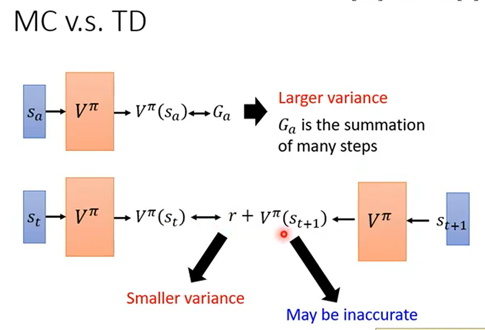
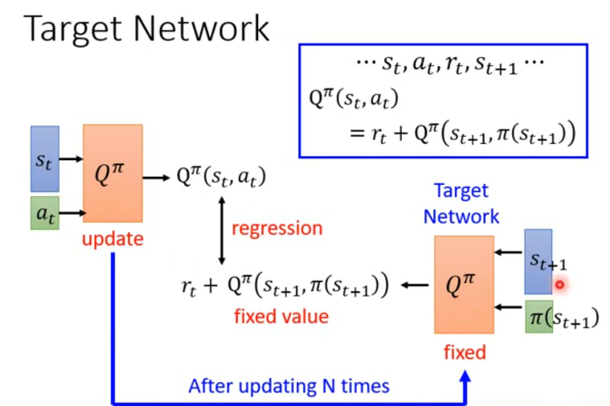
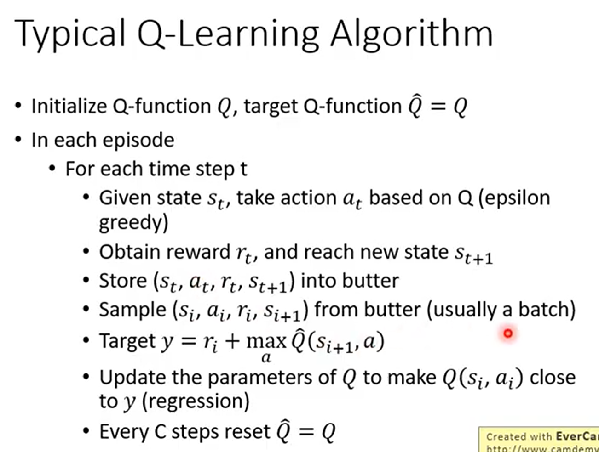
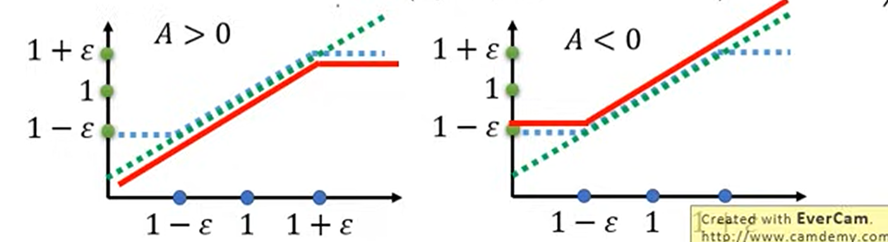

# Policy Gradient

强化学习是什么？我们可以理解为是一个actor，environment，reward的交互过程。actor在环境中采取动作，环境根据动作给出奖励，actor根据奖励调整策略。调整策略的过程其实就是更新模型参数的过程，更新参数也仿照深度学习中的范式，使用经典的SGD，所以就有了我们这里要提到的Policy Gradient方法。

具体来说，普通的监督学习要做的是最小化损失，也就是$\theta \leftarrow \theta - \alpha \nabla_\theta \mathcal{L}$，但是对于强化学习而言，我们的metric应该是reward，也就是说我们进行参数更新的目标应该是最大化reward，所以就有$\theta \leftarrow \theta + \eta \cdot \nabla_\theta J(\theta)$，最大化累积奖励。

接下来让我们分析怎样对$J(\theta)=E[R(\tau)]$求梯度。假设轨迹是从当前策略$\pi_\theta$中采样得到的：

$$
\begin{aligned}
\nabla_\theta J(\theta)
&= \nabla_\theta \sum_{\tau} R(\tau) P_\theta(\tau) \\
&= \sum_{\tau} R(\tau) P_\theta(\tau)\nabla_\theta \log P_\theta(\tau) \\
&= \mathbb{E}_{\tau\sim\pi_\theta}\left[R(\tau)\nabla_\theta\log P_\theta(\tau)\right] \\
&= \mathbb{E}_{\tau\sim\pi_\theta}\left[\sum_{t=1}^{T}
R(\tau)\nabla_\theta\log\pi_\theta(a_t|s_t)\right].
\end{aligned}
$$

但实际上，直接使用推导出来的公式更新参数会有下面几个问题：

1. 如果reward都是正数，那么所有动作的梯度都会被正向放大，且只要reward小于0，就会全部打压。这就会导致哪怕某一步动作很差，只要整局赢了（$R>0$），依然会加强这个坏动作；哪怕某一步动作极好，只要整局输了（$R<0$），依然会削弱这个好动作。

2. 我们的reward在时间上的累计是从1开始的，也就是整局的reward都平均分配给了所有动作，但我们直观想一下，每一步的reward应该从我目前做的动作开始累计，而跟之前的动作不应该有关系，并应该随着时间的推移，影响越来越小。

所以针对这两个问题，我们给出的解决方案是：

1. 增加baseline，构造优势函数计算相对大小：$A_t=G_t-b(s_t)$。baseline通常使用$V(s_t)$来近似。

2. 让reward从当前动作开始累计，增加衰减因子$\gamma$（$\gamma<1$）：

$$G_t=\sum_{k=t}^{T}\gamma^{k-t}r_k$$

最后我们得到最终梯度式：

$$
\nabla_\theta J(\theta)
\approx \frac{1}{N}\sum_{n=1}^{N}\sum_{t=1}^{T_n}
\nabla_\theta\log\pi_\theta(a_t^{(n)}|s_t^{(n)})
\left(G_t^{(n)}-b(s_t^{(n)})\right)
$$

# Actor-Critic

对于Actor-Critic，我们刚才已经提到了一些。总结下来，就是引入一个Critic来指导Actor的策略学习。也就是说，需要训练两个网络，Actor直接学策略，Critic指导改进。

Actor-Critic的训练过程可以概括为：

1. **Actor采样动作**：根据当前策略$\pi_\theta(a|s)$与环境交互。
2. **Critic计算TD误差**：利用即时奖励和下一状态的价值估计，得到$\delta_t$。
3. **Actor更新策略**：将$\delta_t$作为Advantage估计，通过策略梯度调整动作概率。
4. **Critic更新价值函数**：最小化TD预测误差，提高状态价值估计的准确性。
5. **重复交互与更新**：Actor和Critic相互配合，逐步提升策略表现。

核心思想是：**Actor负责学习如何选择动作，Critic负责评价当前行为是否比预期更好，并为Actor提供策略更新信号。**

```
Actor（策略网络）           Critic（价值网络）
  输入：状态 s                 输入：状态 s
  输出：π_θ(a|s) 概率分布     输出：V_φ(s) 标量
  作用：选动作                作用：评估状态价值
  参数：θ                     参数：φ
```

Actor-Critic本身不是固定的On-Policy或Off-Policy算法，具体要看数据是怎么采样和复用的。比如A2C、A3C通常是On-Policy，而DDPG、TD3、SAC通常是Off-Policy。

# On-Policy and Off-Policy

首先先介绍一下On-Policy和Off-Policy的区别：

- **On-Policy**：训练时使用的行为策略，和当前要优化的策略是同一个策略，或者至少是刚刚更新前的当前策略。数据一般只使用一轮，更新后重新和环境交互采样。
- **Off-Policy**：行为策略和目标策略可以不同，训练时可以使用由旧策略、探索策略或者replay buffer产生的数据。

不难看出，我们刚才最开始的Policy Gradient分析就是On-Policy的策略。因为公式中的期望是从$\pi_\theta$采样得到的，采样策略和正在求梯度的策略是同一个策略。

On-Policy方法的一个弊端，就是我们每次更新参数的时候都需要重新和环境交互，采样新的数据，这样的效率是比较低的。对于Off-Policy方法，我们可以有一个行为策略$\pi_{\theta'}$与环境交互产生数据，然后使用这些数据来更新目标策略$\pi_\theta$。

这时两个策略的分布不同，就需要使用Importance Sampling。简单来说，就是如何用$q(x)$的样本去估计$p(x)$的期望值，假设我们有一个函数$f(x)$，我们想要计算$p(x)$下的期望值：

$$
\begin{aligned}
\mathbb{E}_{x\sim p(x)}[f(x)]
&= \int f(x)p(x)dx \\
&= \int f(x)\frac{p(x)}{q(x)}q(x)dx \\
&= \mathbb{E}_{x\sim q(x)}\left[f(x)\frac{p(x)}{q(x)}\right]
\end{aligned}
$$

但是，如果目标分布$p$与行为分布$q$差距较大，且可用样本数量不足时，重要性采样的估计方差会急剧增大，样本均值会严重偏离真实期望，导致估计结果不可靠。

在强化学习中，如果严格地对整条轨迹进行重要性采样，那么权重应该是：

$$
\frac{P_\theta(\tau)}{P_{\theta'}(\tau)}
=\prod_{t=1}^{T}\frac{\pi_\theta(a_t|s_t)}{\pi_{\theta'}(a_t|s_t)}
$$

这里环境的状态转移概率在分子分母中会抵消，因为环境本身不依赖于策略。但是，这并不意味着状态分布$p_\theta(s_t)$和$p_{\theta'}(s_t)$相同。不同的策略会选择不同的动作，从而访问到不同的状态。也正因为完整轨迹的重要性权重方差很大，实际算法通常会使用逐动作的近似、critic或者其他方法来降低方差。

# Q-learning

Q-learning是一个典型的Off-Policy方法。我们可以使用$\epsilon$-greedy这样的行为策略和环境交互，同时学习一个趋向于贪心策略的Q函数。行为策略和目标策略不需要完全相同，这就是它和前面On-Policy方法的区别。

## 为什么需要critic？

我们回看Policy Gradient中的公式，可以发现主要是通过优势函数$A$来进行参数更新的，而前面我们提到，$A_t=G_t-b(s_t)$，但这时baseline的值我们是不知道的，所以需要训练一个价值函数，这就是Critic。

所以，Critic的作用在这里更多是评价一个策略$\pi$的好坏，我们通常记为$V^\pi(s)$，相当于提供了一个“正常发挥水平”，也就是说，在Actor-Critic中，一般是Critic帮助计算advantage，再让Actor更新。

那既然Critic能给每个动作打分，那我们可不可以直接训练这个Critic，把它训练得足够强然后直接用它选动作，这样就不再需要再去训练Actor了呢？由此，就引出了我们下面要介绍的Q-learning方法。

## MC or TD

在正式介绍Q-learning之前，我们先来了解一下评估$V^\pi(s)$的两种方法：MC和TD。

MC，蒙特卡洛方法，核心思想就是一条轨迹完整跑完之后，用实际获得的累计奖励作为价值目标。我们可以想象有一个Critic观察某一个策略$\pi$的行为，记录后续所有的奖励。他的目标是：

$$V(s_t)\leftarrow G_t$$

TD，时序差分方法，它不需要等待整条轨迹结束，而是每走一步就根据当前信息修正，认为当前状态的价值应该约等于当前奖励加上下一个状态的价值，目标为：

$$V(s_t)\leftarrow V(s_t)+\alpha\left[r_t+\gamma V(s_{t+1})-V(s_t)\right]$$



比较这两种方法，MC得到的评估会更加真实，因为是在真实追踪reward，不依赖当前价值网络自己的预测，但是方差会很大，因为同一个状态后续可能会有很多的随机结果；而TD只是对当前的一步就进行更新，所以方差很小，但由于我们使用了自己的预测，所以会带来一定的偏差。

## Q-learning Basic

### 从 $V(s)$ 变成 $Q(s,a)$

我们前面说到，Q-learning的主要思想就是：当Critic评价的是每个动作时，我们可以直接根据它的评价生成策略，不再需要单独训练Actor。也就是说，Q-learning学习的是价值，通过价值选策略。

所以，这里定义动作价值函数：

$$Q_\pi(s,a)=\mathbb{E}_\pi\left[\sum_{t=0}^{\infty}\gamma^t r_t\mid s_0=s,\,a_0=a\right]$$

它回答：在状态$s$下，先执行动作$a$，之后继续按照策略$\pi$行动，未来总回报是多少。

因此，如果Critic能准确估计每个动作的Q值，策略其实可以直接写成：

$$\pi(s)=\arg\max_a Q(s,a)$$

也就是每一步选择Q值最大的动作。

因此，一个动作的价值应该等于当前奖励加未来价值，那么我们就有了Q-learning训练的目标：

$$Q(s_t,a_t)\leftarrow r_t+\gamma\max_{a_{t+1}}Q(s_{t+1},a_{t+1})$$

### Target Network

观察上一个式子，我们可以发现，其实当前预测$Q_\theta(s_t,a_t)$在变，目标值$Q_\theta(s_{t+1},a')$也在变，这样的话目标不确定，会造成训练非常不稳定。

所以，Target Network的做法是，先把评分标准固定一段时间，让你朝这个固定目标学习；过一段时间，再更新一次评分标准。

大概流程可以总结为：固定Target→Online学习若干步→同步Target→继续学习。



### Exploration

分析了这么多，可能到这里会有第一个疑惑了，每一步选择Q值最大的动作的话，那么在一开始Q不稳定的时候，如果某一个Q值非常大，选择它之后，后面可能就会一直重复这个动作，这显然不是我们想要的，所以这里就需要平衡exploration和exploitation了。

常见的一种叫做$\epsilon$-greedy：

$$
a=\begin{cases}
\text{随机动作}, & \text{概率 }\epsilon \\
\arg\max_{a'}Q(s,a'), & \text{概率 }1-\epsilon
\end{cases}
$$

例如，$\epsilon=0.1$意味着：90%概率选择目前Q值最大的动作，10%概率随机尝试其他动作。（$\epsilon$会随着学习不断衰减）

所以，我们在这里可以给出一个结论了，Q-learning是一种Off-Policy的算法，因为我们的exploration决定了，实际执行的策略不一定是Q值最大的目标策略。

### Algorithm

最后总结一下Q-learning的算法，其实在实现上是用了一个buffer把智能体与环境交互产生的数据先存起来，之后再反复抽样训练。



# PPO

刚才我们介绍了On-Policy和Off-Policy的区别。标准Policy Gradient属于On-Policy方法，但是它有一个问题：每次采样的数据通常只更新一次，样本利用率比较低。PPO的想法就是，在旧策略采样得到的一批数据上进行多轮更新，同时限制新旧策略不要差距太大。

这里需要注意，PPO虽然使用了重要性比率，但通常仍然被归类为On-Policy算法。因为每一轮更新结束后，旧数据会被丢弃，再用更新后的策略重新和环境交互。它和Q-learning、SAC那种长期复用replay buffer的Off-Policy算法不一样。

具体来说，令$\pi_{\theta_{\mathrm{old}}}$为采样数据时使用的旧策略，$\pi_\theta$为正在更新的策略，那么重要性比率为：

$$r_t(\theta)=\frac{\pi_\theta(a_t|s_t)}{\pi_{\theta_{\mathrm{old}}}(a_t|s_t)}$$

PPO有两种常见的约束方式。一种是增加KL项进行约束：

$$
\begin{aligned}
J_{\text{PPO-penalty}}(\theta)
&=\mathbb{E}_{(s_t,a_t)\sim\pi_{\theta_{\mathrm{old}}}}
\left[r_t(\theta)\hat A_t\right]
-\beta\operatorname{KL}(\pi_{\theta_{\mathrm{old}}}\|\pi_\theta)
\end{aligned}
$$

对$\beta$的选取，可以根据实际KL大小动态调整：

- If $\operatorname{KL}>\operatorname{KL}_{max}$, increase $\beta$
- If $\operatorname{KL}<\operatorname{KL}_{min}$, decrease $\beta$

除了这种KL的约束方式，还有一种PPO是通过clip的方式来约束的：

$$
J_{\text{PPO-clip}}(\theta)
\approx \mathbb{E}_{(s_t,a_t)\sim\pi_{\theta_{\mathrm{old}}}}
\left[\min\left(
r_t(\theta)\hat A_t,
\operatorname{clip}\left(r_t(\theta),1-\varepsilon,1+\varepsilon\right)\hat A_t
\right)\right]
$$



这里可以被理解为：如果$\hat A_t>0$，意味着我们当前的action应该得到正的收益，也就是希望$r_t(\theta)$尽可能大，但如果大于$1+\varepsilon$，就不再增加收益；如果$\hat A_t<0$，意味着我们当前的action应该得到负的收益，也就是希望$r_t(\theta)$尽可能小，但如果小于$1-\varepsilon$，就不再减少收益。

最后总结一下：

**PPO-penalty**
$$J(\theta)=\mathbb{E}\left[r_t(\theta)\hat A_t\right]-\beta\operatorname{KL}(\pi_{\theta_{\mathrm{old}}}\|\pi_\theta)$$

**PPO-clip**
$$J(\theta)=\mathbb{E}\left[\min\left(r_t(\theta)\hat A_t,\operatorname{clip}(r_t(\theta),1-\varepsilon,1+\varepsilon)\hat A_t\right)\right]$$
